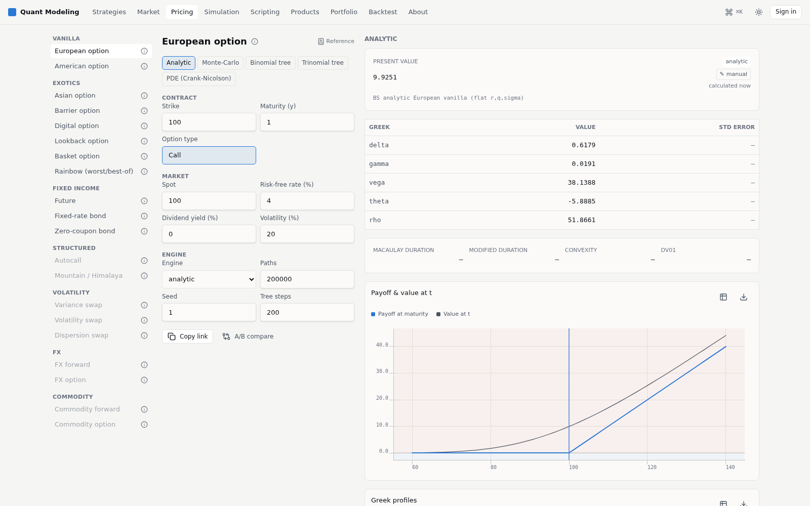
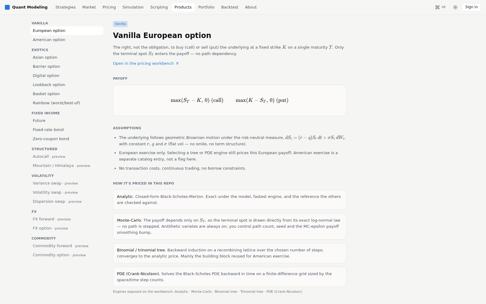
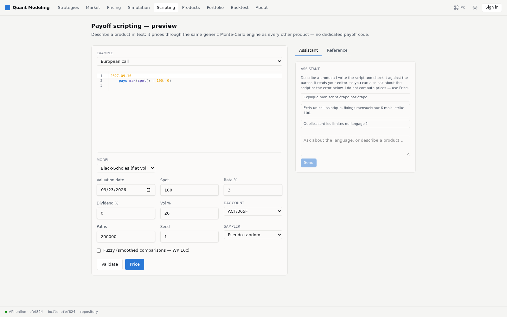

# Quant Modeling

A derivatives pricing and counterparty-risk library written the way a desk
would build one — C++20 core, exposed all the way to a usable product — built
solo, end to end: pricing and xVA engines, API, and front end.

[](https://github.com/HadrienT/quant-modeling/actions/workflows/ci.yml)
[](LICENSE)


**[quant.tramonihadrien.com](https://quant.tramonihadrien.com)** — live demo, self-hosted
(no cloud).

---

## What this is

`include/quantModeling` + `src` is a C++20 pricing library, split the way a
desk library is split: **instruments** (payoffs) know nothing about market
data; **models** know nothing about how they're solved; **engines**
(analytic, tree, PDE, Monte Carlo, exposure) know nothing about which product
they're pricing; a **pricer registry** wires the three together per product.
No engine branches on a product type; no instrument reads market data. A
**risk** layer on top turns simulated exposures into xVA and regulatory
capital.

That library is then carried all the way to something a non-engineer can use:

```
C++20 core  →  pybind11 bindings  →  FastAPI service  →  React front end
```

Every layer is real, tested, and in the same repo: ~77k lines of C++ behind
1,200+ GoogleTest cases (plus an AddressSanitizer/UBSan build), a typed Python
API with its own pytest suite, and a React app whose types are generated from
the API's OpenAPI schema — with CI that fails the build on drift.

## Screenshots

**Pricing workbench** — pick a product, an engine, a model; get the price,
the full Greek profile, and a payoff chart, side by side.



**Product catalog** — every instrument documented with its payoff formula,
model assumptions, and which numerical methods price it (and why they should
agree).



**Scripting assistant** — describe a payoff in plain language; a local LLM
drafts it in the project's own payoff DSL and checks the draft against the
real parser before showing it to you. No made-up syntax reaches the screen.



## Highlights

- **A fixed catalogue, on purpose**: about 25 instruments across vanilla,
  exotics (Asian, barrier, digital, lookback, basket, rainbow), structured
  (autocall, mountain/Himalaya), volatility swaps, rates (swaps, swaptions,
  Bermudans, caps), credit, FX and commodity. The roadmap is depth, not one
  more payoff.
- **Models and methods**: Black-Scholes, Heston, Bates, SABR, Dupire local
  vol, stochastic-local vol, rough Bergomi, Merton and Kou jumps, Hull-White
  / Vasicek / CIR, Garman-Kohlhagen — priced by closed forms, trees,
  Crank-Nicolson PDE and Monte Carlo (Heston QE, a rough Bergomi hybrid
  scheme, Longstaff-Schwartz) with antithetic and control variates, Sobol
  sequences and a Brownian bridge.
- **Calibrated on real, traded data**: SVI per maturity and Dupire local vol
  from stored option chains; Heston fitted to that surface, and a
  stochastic-local-vol leverage (particle method) on top; multi-curve
  discounting from traded swaps, and Hull-White fitted to normal vols implied
  from the swaption trades the DTCC publishes.
- **A payoff scripting language** (lexer → parser → AST → fuzzy-logic
  evaluator, Andreasen–Savine style): one generic Monte-Carlo engine prices
  *any* scripted payoff, early exercise included, instead of a dedicated code
  path per product. The model is read off the script, announced, and every
  dynamics can be compared on one seed. A frozen library of 42 structures
  from Bouzoubaa & Osseiran is priced from a term sheet.
- **Adjoint algorithmic differentiation**: an operator-overloading tape
  computing full Greek vectors in roughly the cost of one extra valuation —
  carried through the calibration (Dupire on the tape, the SVI fits by the
  implicit function theorem) to **the vega of any scripted product to each
  quoted option of the chain**.
- **xVA, following Gregory's *The xVA Challenge***: Monte-Carlo exposure of a
  netting set (one currency, two currencies, or a rate and a share), netting
  and collateral, initial margin (SIMM), then CVA, DVA, FVA, MVA and KVA with
  their Monte-Carlo errors, regulatory capital (SA-CCR, the revised CVA
  framework), and the sensitivities of the CVA by adjoint differentiation. A
  portfolio's trades are booked against counterparties and netting sets,
  marked daily, and their xVA computed on stored market data.
- **Property-based tests over exact-number tests**: call-put parity,
  `in + out = vanilla`, monotonicity bounds, measured log-log convergence
  order — not just "this number equals that number."

## Monte-Carlo on two GPUs

Payoff scripts compile to a stack-machine bytecode that runs unchanged on the
CPU and in a CUDA kernel on two Tesla V100s, with prices and model risks
(forward-mode duals, a hand-written per-path adjoint for local vol). Every
path is a pure function of (seed, path index) and every reduction follows the
path indices, so **one GPU, two GPUs and the CPU give the same number** — bit
for bit between GPU counts, to 1e-12 against the CPU. Wall time to a 1e-4
relative standard error (1e-3 on the delta for the superbucket), the CPU
columns running the kernels' own per-path code
(`build-cuda/qm_gpu_table_bench`; `*` = timed on a fraction and scaled):

| Pseudo-random | Paths | CPU 1 thread | CPU 8 threads | 1 V100 | 2 V100 |
|---|---|---|---|---|---|
| Vanilla Black-Scholes | 1.25e8 | 8.9 s | 1.3 s | 28 ms | 17 ms |
| Up-and-out, daily, local vol | 1.55e8 | 169 min * | 27 min * | 25.2 s | 12.7 s |
| Worst-of autocall, 3 assets | 3.8e6 | 10.3 s | 1.5 s | 41 ms | 34 ms |
| Superbucket (363 local-vol risks) | 8.5e5 | 51.5 s * | 7.5 s | 237 ms | 237 ms |

| Sobol RQMC + Brownian bridge | Paths | CPU 1 thread | CPU 8 threads | 1 V100 | 2 V100 |
|---|---|---|---|---|---|
| Vanilla Black-Scholes | 1.3e5 | 17 ms | 3 ms | 5 ms | 6 ms |
| Up-and-out, daily, local vol | 3.4e7 | 35 min * | 291 s * | 4.5 s | 2.3 s |
| Worst-of autocall, 3 assets | 1.0e6 | 2.8 s | 478 ms | 10 ms | 9 ms |
| Superbucket (363 local-vol risks) | 1.6e4 | 695 ms | 119 ms | 13 ms | 14 ms |

The exposure engine of the xVA runs there too: a netting set of 10 swaps and
swaptions under a CSA, netted, collateralised and reduced on the cards, to a
0.05 % relative standard error of its CVA (126 439 paths, 198 dates;
`build-cuda/qm_gpu_exposure_bench`):

| | CPU 1 thread | CPU 16 threads | 1 V100 | 2 V100 |
|---|---|---|---|---|
| CVA of a collateralised netting set | 71.5 s | 8.2 s | 206 ms | 141 ms |

A card joins a run only with enough work (128 logical blocks) to pay for its
start-up; small runs stay on one. Design, measurements and decisions:
[`blueprint/wp/19-gpu.md`](blueprint/wp/19-gpu.md).

## Stack

| Layer | Tech |
|---|---|
| Pricing core | C++20, CMake, vcpkg, Eigen, GoogleTest, Google Benchmark, ASan/UBSan |
| Bindings | pybind11 → a `quantmodeling` wheel |
| API | FastAPI, Pydantic, PostgreSQL, JWT + Google OAuth (PKCE) |
| Front end | React 19, TypeScript, Vite, TanStack Query/Router/Table, Tailwind, react-three-fiber (WebGL vol surfaces), CodeMirror, Storybook, Vitest, Playwright |
| Ops | Docker Compose, GitHub Actions, OpenTelemetry, an audit trail on Kafka, self-hosted behind a Cloudflare Tunnel (no cloud provider) |

Three sibling repositories carry what is not pricing: `data-ingest` (market
data into Postgres),
[`quant-platform`](https://github.com/HadrienT/quant-platform) (audit
events, logs, metrics and traces) and
[`quant-backtest`](https://github.com/HadrienT/quant-backtest) (the C++
backtest engine behind the Backtest page).

## Quality bar

- **C++**: every new engine or instrument ships with a test — ideally a
  property test, not a single numeric equality — and passes an
  AddressSanitizer + UBSan build, not just the release one.
- **Contract-checked API**: the OpenAPI schema and the generated TypeScript
  client are committed; CI regenerates both and fails on any diff.
- **Front-end discipline enforced by lint, not convention**: features can't
  import each other, `shared/` can't import a feature, and no feature file
  exceeds 230 lines — checked by a dedicated test, not a code-review habit.
- **Every valuation can be replayed**: each pricing emits an audit event
  with its inputs, seed and model, and an endpoint re-runs it and compares.
- **An internal engineering log**: [`CLAUDE.md`](CLAUDE.md) documents the
  actual conventions this repo runs on (build commands, coding conventions,
  deployment model) — written for an AI pair-programming agent, but it's the
  same document a human contributor would need.

## Running it

The C++ core is fully self-contained and builds standalone:

```bash
git clone https://github.com/HadrienT/quant-modeling.git
cd quant-modeling
cmake --preset default && cmake --build build
ctest --test-dir build --output-on-failure
```

The API and front end are real too, but market data (prices, option chains,
FRED curves, traded swaps and swaptions, credit spreads) comes from a separate
`data-ingest` Postgres this public repo doesn't publish — `docker compose up --build` needs `PGPASSWORD` pointed at
one to fully come up. The live demo above is the fastest way to see the whole
stack running end to end; the full command reference (wheel build, sanitizer
preset, Python tests, OpenAPI regeneration) is in [`CLAUDE.md`](CLAUDE.md).

## License

[MIT](LICENSE)
